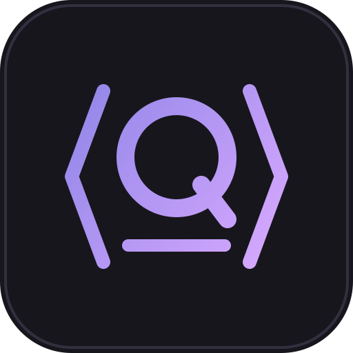

<div align="center">



# Quantus

### A calculator for physical quantities, with LaTeX in and LaTeX out

*Type a formula, press enter, and get the working: symbolic, substituted, solved.*


[Features](#-features) •
[Building](#-building) •
[Usage](#-usage) •
[Interface](#-interface) •
[Documentation](#-documentation)

</div>

---

Quantus is a desktop calculator for SI units and symbolic maths. You write in a
MathLive formula editor (or straight in LaTeX), evaluate with <kbd>⏎</kbd>, and
get the calculation back in three steps. The engine is a Rust library that the
Tauri app calls directly: no server and no child process.

```
m_1 = 2kg                       →   m_1 = 2\,\mathrm{kg}
F = m_1 \cdot 9{,}81\frac{m}{s^2}
    SYMBOLIC     F = m_{1} \cdot 9{,}81\,\frac{\mathrm{m}}{\mathrm{s}^{2}}
    SUBSTITUTED  F = 2\,\mathrm{kg} \cdot 9{,}81\,\frac{\mathrm{m}}{\mathrm{s}^{2}}
    RESULT       F = 19{,}62\,\mathrm{N}
```

> ⚠️ **Early and unreleased.** The engine was ported from Kotlin/Spring to
> Rust and the app from Electron to Tauri. The user interface is in German.

## ✨ Features

<table>
<tr>
<td width="50%" valign="top">

### ✍️ Input
- **Formula editor** (MathLive): `/` makes a fraction, `*` a `\cdot`, `^` and `_` super- and subscripts, `2kg` a number with a unit
- **LaTeX source** for exact input, such as `\qty{12}{cm}` or `\sqrt[3]{27}`, with a live preview underneath
- Switch between the two at any time with <kbd>\\</kbd>; the content carries over both ways

</td>
<td width="50%" valign="top">

### 🧮 Calculation
- **Exact numbers** with arbitrary precision (`dashu`, `astro-float`)
- **Units and dimensions** are checked and converted, and results are named (`N`, `J`, …)
- **Session variables**: an indexed label such as `m_1 = 2kg` defines a variable for the session
- Parser errors report the **position** in the input

</td>
</tr>
<tr>
<td colspan="2" valign="top">

### 📋 Output
Every result comes with its working in three stages, and can be copied as
LaTeX (<kbd>Ctrl</kbd>+<kbd>Shift</kbd>+<kbd>C</kbd>) or as a whole `align*`
block (<kbd>Ctrl</kbd>+<kbd>Alt</kbd>+<kbd>C</kbd>). A variables panel and a
history panel keep track of the session.

</td>
</tr>
</table>

## 🔨 Building

**You need:**

| | |
|---|---|
| 🦀 **Rust** | stable, edition 2021 |
| 🟢 **Node** | 20 or newer |
| 🐧 **Linux** | WebKitGTK 4.1 and the usual GTK development packages, see the [Tauri prerequisites](https://v2.tauri.app/start/prerequisites/) |

```sh
cargo test --workspace   # engine tests, golden files and Tauri IPC tests

cd desktop
npm install              # once; also copies the MathLive fonts to public/fonts
npm run dev              # Vite dev server + Tauri window with hot reload
npm run typecheck        # check the TypeScript
npm run bundle           # build the AppImage and .deb
```

> 💡 **Tip:** `npm install` has to run in `desktop/`, not in the repository root.

<details>
<summary><b>📦 Packaging</b></summary>

<br>

`npm run bundle` runs `tauri build` and puts the AppImage and the `.deb` in
`target/release/bundle/`. The AppImage (~100 MB) ships WebKitGTK; the `.deb`
(~6 MB) depends on the system's WebKitGTK. The desktop entry comes from
`desktop/src-tauri/packaging/quantus.desktop`, and the icons are generated from
`desktop/build/icon.svg` with `npx tauri icon`.

```sh
cd desktop && npm run bundle
../target/release/bundle/appimage/Quantus_0.1.0_amd64.AppImage
```

</details>

<details>
<summary><b>🧱 How the code is laid out</b></summary>

<br>

| Path | What it does |
|---|---|
| `crates/quantus-core/src/num.rs`, `quantity.rs` | Numbers and `PhysicalQuantity` |
| `crates/quantus-core/src/units/` | Unit table, dimensions, conversion, naming |
| `crates/quantus-core/src/latex/` | Lexer, parser, AST, serializer |
| `crates/quantus-core/src/eval/` | AST evaluation, substitution, steps |
| `crates/quantus-core/src/session.rs`, `api.rs` | Session variables and the app's JSON types |
| `crates/quantus-core/tests/` | Golden tests, carried over from the Kotlin tests |
| `desktop/src-tauri/` | Tauri shell: commands, menu, single instance, bundling |
| `desktop/src/` | React renderer: formula editor, LaTeX source, steps, panels |

Numbers, units and LaTeX I/O depend on each other in one direction only. The
Tauri commands know nothing but `api` and `SessionStore`.

</details>

## 🎹 Usage

| Key | Action |
|---|---|
| <kbd>⏎</kbd> | evaluate |
| <kbd>Ctrl</kbd>+<kbd>N</kbd> | new calculation |
| <kbd>Ctrl</kbd>+<kbd>J</kbd> | show or hide the working |
| <kbd>Ctrl</kbd>+<kbd>,</kbd> / <kbd>Ctrl</kbd>+<kbd>H</kbd> | variables / history panel |
| <kbd>Ctrl</kbd>+<kbd>Shift</kbd>+<kbd>C</kbd> | copy the result as LaTeX |
| <kbd>Ctrl</kbd>+<kbd>Alt</kbd>+<kbd>C</kbd> | copy the whole calculation as an `align*` block |
| <kbd>\\</kbd> or <kbd>Ctrl</kbd>+<kbd>L</kbd> | switch between formula editor and LaTeX source |
| <kbd>Esc</kbd> | leave the source · close a panel |

**Two ways to type.** The formula editor is the quick one. Arrow <kbd>→</kbd>
leaves an index or any other bracket, so `m_1` `→` `= 2kg` defines the
variable. The LaTeX source is the exact one: a backslash switches to it while
you type, and from then on what you write is what you get.

**Variables** always carry an index (`r_1`, `v_1`). An input with an indexed
label is a definition (`m_1 = 2kg`) and stays valid for the session. A label
without an index (`F = …`) only names the line.

## 🔌 Interface

The renderer calls Tauri commands (`desktop/src/api.ts`), which call
`quantus_core::api`:

```
evaluate         { request: { latex, sessionId?, precision? } }
                 → { input, latex, result, steps[], alignBlock,
                     value, unit, quantityName, dimension, variable }
define_variable  { request: { latex: "r_1 = 0{,}5m", … } } → Variable
list_variables   { sessionId? }               → [ { key, symbol, latex, value, unit } ]
delete_variable  { key, sessionId? }          forget a variable
```

Errors come back as `{ error, position }`. For parser errors, `position`
(0-based) points at the spot in the input.

## 📚 Documentation

| | |
|---|---|
| 📐 [`spec-si-rechner-v2.md`](spec-si-rechner-v2.md) | The specification (German) |
| 🔀 [`migration-rust-tauri.md`](migration-rust-tauri.md) | Plan and findings of the move to Rust and Tauri (German) |
| 🧪 [`docs/phase0-findings.md`](docs/phase0-findings.md) | Results of the early library spikes (German, historical) |

Code, comments and error messages are in English. The project documentation
(spec, findings) is in German, and so is the interface.

## 📜 License

Quantus is released under the MIT license, as declared in `Cargo.toml`.

<div align="center">

---

<sub>Made with 🧮 for people who like to see the working.</sub>

</div>
